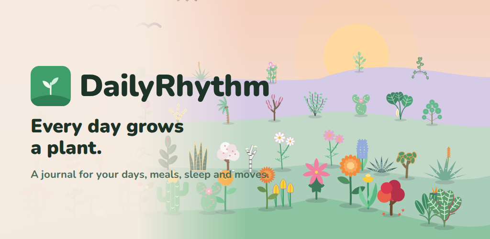
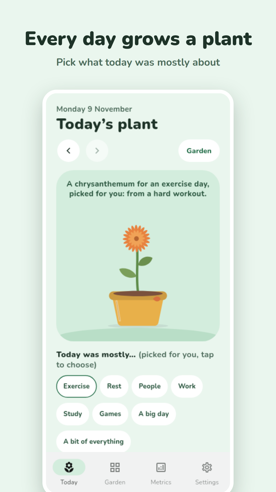
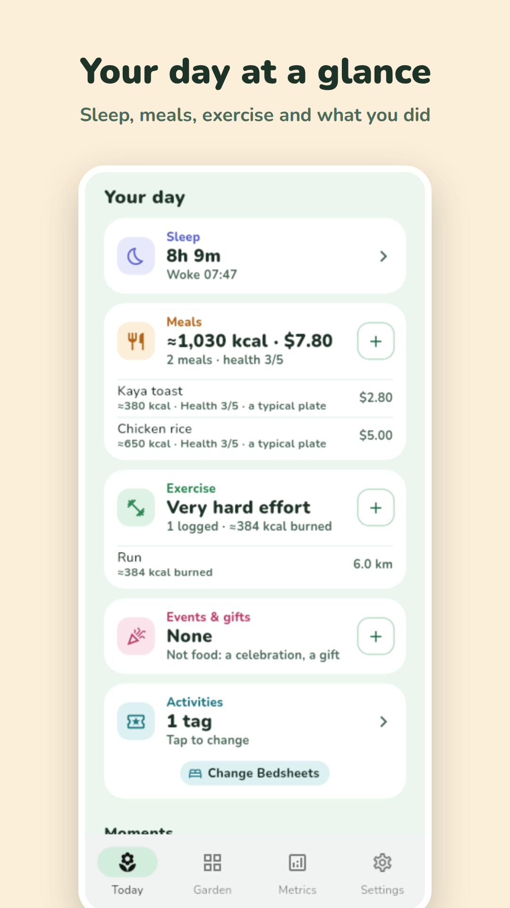
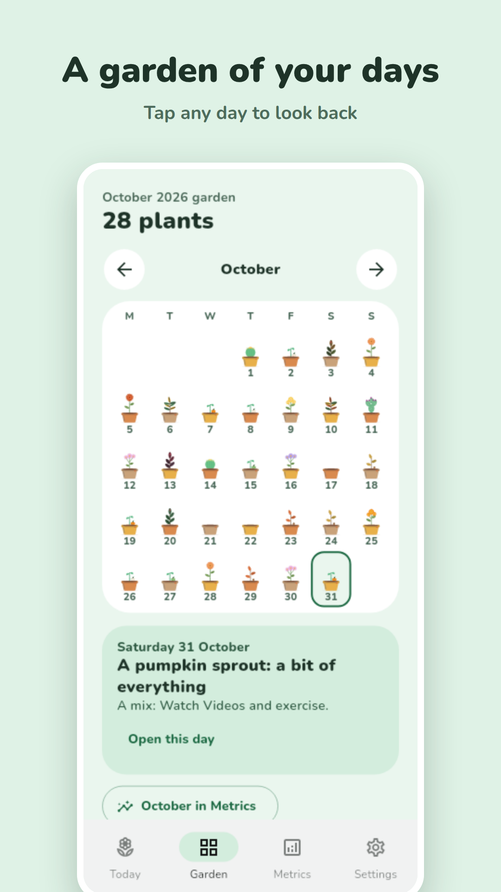
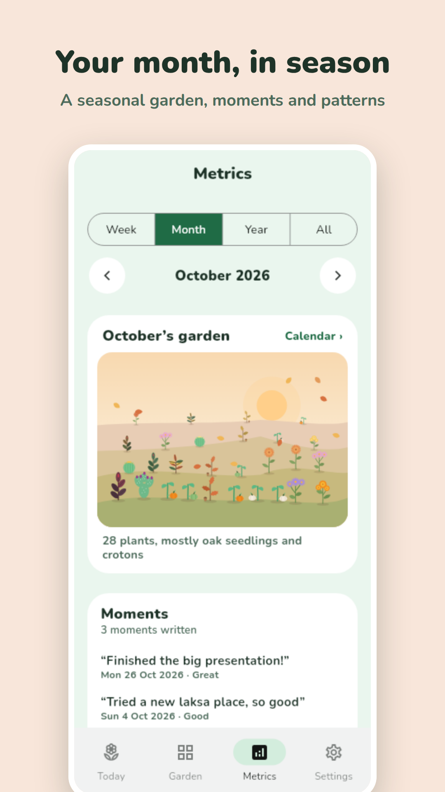
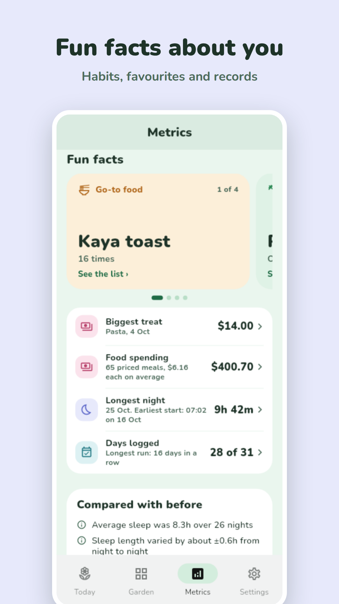
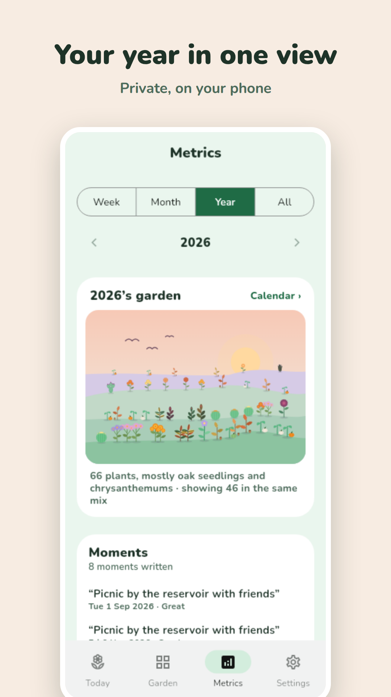

<p align="center">
  
</p>

<h1 align="center">DailyRhythm</h1>

<p align="center">
  <b>A local-first daily journal that grows a memory garden.</b><br>
  Log how your day went, what you ate, how you slept and how you moved, and every day becomes a plant.
</p>

<p align="center">
  <a href="https://notyusheng.github.io/DailyRhythm/">Website</a> ·
  <a href="https://notyusheng.github.io/DailyRhythm/privacy-policy.html">Privacy</a> ·
  <a href="DEVELOPMENT.md">Build it yourself</a>
</p>

<!-- When the Play listing is public, add the "Get it on Google Play" badge here:
     https://play.google.com/store/apps/details?id=com.dailyrhythm.dailyrhythm -->
<p align="center"><i>Coming soon to Google Play.</i></p>

<p align="center">
  
  
  
  
  
  
</p>

## Why DailyRhythm

Most trackers turn your life into charts and streaks. DailyRhythm keeps a **memory garden** instead: each day grows a plant that says what kind of day it was (work, study, exercise, people, rest, games, a big day out, or a bit of everything). Nothing wilts and no streak breaks. A day you didn't log is simply an empty pot.

The numbers are still there when you want them, in Metrics. They show patterns without telling you what to do.

## What you can log

- **How the day went:** mood, plus energy, stress and focus compared with a usual day.
- **Meals:** what you ate, where from, what it cost and its calories. There's offline calorie search over 7,000+ USDA foods, Open Food Facts lookup, barcode scanning, and a 1–5 health score for each meal.
- **Sleep:** bedtime and wake time, with naps. You can also sync steps and sleep from **Health Connect**, read-only.
- **Exercise:** sets, reps, runs and distances. Each exercise day gets an effort rating, Light to Very hard, and a calorie estimate.
- **Activities and symptoms:** your own tags, in groups (Chores, Appointments, Work…) with icons you can pick.
- **Moments:** a few words about something that happened, with a mood and what it was about.

## What you get back

- **The garden:** every day as a plant, and seasonal plants and pots that change through the year. The month and the year appear as gardens of hills that sway gently.
- **Metrics:** an overview of every day by sleep, steps, calories, mood, effort or meal health, with weekday patterns, effort and food breakdowns, and how each period compares with the last.
- **Fun facts:** your favourite food, the weekday you most often eat it, the exercise you do most, how far you've walked in landmarks, and what you did on this day in past years.

## Private by design

- **On your phone:** your journal stays there. There are no accounts, no ads, no analytics and no DailyRhythm servers.
- **Backups are yours:** export to a file, or back up to your own Google Drive. The app can only see the files it creates there.
- **AI is optional and bring-your-own:** connect OpenAI, Anthropic, Gemini, OpenRouter, or a model you run at home over Tailscale. Only what a feature needs is sent, such as a food's name for a calorie estimate. Your journal never is. See the [AI guide](https://notyusheng.github.io/DailyRhythm/ai.html).

Read the full [privacy policy](https://notyusheng.github.io/DailyRhythm/privacy-policy.html).

## Build it yourself

DailyRhythm is a Flutter app (Android first). To run it:

```bash
flutter pub get
flutter run -d android   # or -d linux for a quick desktop run
```

Setup, signing, releases and Google Sign-In configuration are in [DEVELOPMENT.md](DEVELOPMENT.md). The database is described in [SCHEMA.md](SCHEMA.md).

## Licence

[MIT with the Commons Clause](LICENSE): free to use, study and change; not to be sold.

Made by [NotYuSheng](https://github.com/NotYuSheng).
